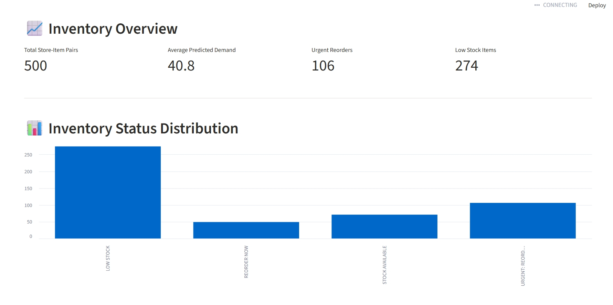
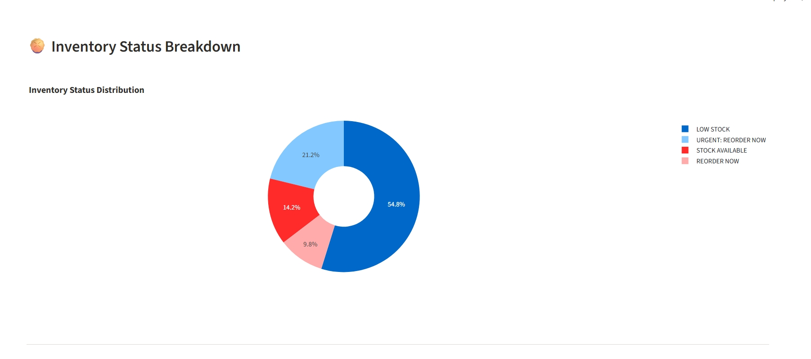
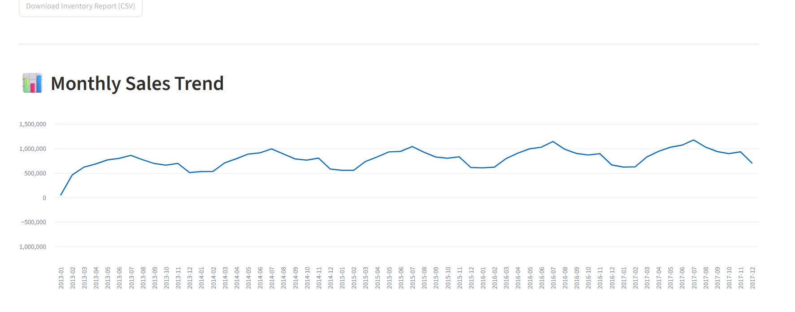
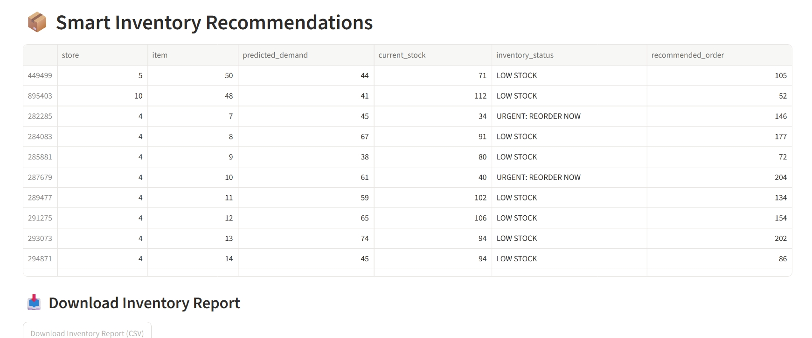
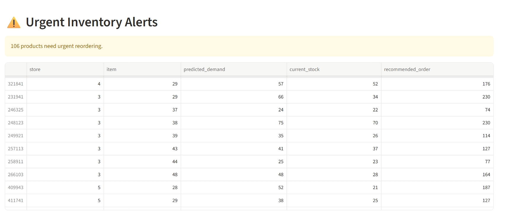

# 📊 Retail Demand Forecasting & Smart Inventory Alert System

A Machine Learning-based project that predicts next-day retail product demand and provides smart inventory recommendations to help retailers manage stock efficiently.

## 🎯 Project Overview

Retail businesses often face challenges in maintaining the right inventory levels. Overstocking increases storage costs, while understocking can lead to lost sales and missed business opportunities.

This project uses historical retail sales data and Machine Learning techniques to forecast product demand and generate smart inventory alerts.

The system helps retailers make better inventory decisions through demand predictions, stock monitoring, and reorder recommendations.

## ✨ Key Features

- **Demand Forecasting:** Predicts next-day product demand using Machine Learning.
- **Smart Inventory Alerts:** Identifies urgent reorders, low-stock items, and available stock.
- **Inventory Recommendations:** Calculates reorder points and recommended order quantities.
- **Interactive Dashboard:** Displays inventory insights through Streamlit.
- **Data Visualization:** Includes inventory status charts and monthly sales trends.
- **CSV Export:** Allows users to download inventory reports.
- **Interactive Filters:** Filter inventory by store, item, and stock status.

## 🛠️ Technologies Used

- Python
- Pandas
- NumPy
- Scikit-learn
- Matplotlib
- Plotly
- Streamlit
- Joblib
- Git and GitHub

## 🤖 Machine Learning Model

**Algorithm:** HistGradientBoostingRegressor

The model uses historical sales information and engineered features, including:

- Store and item identifiers
- Year, month, and day
- Day of the week
- Lag features (1, 7, and 28 days)
- Rolling averages (7 and 28 days)

### Model Performance

| Metric | Result |
|---|---:|
| Mean Absolute Error (MAE) | 6.27 |
| Root Mean Squared Error (RMSE) | 8.16 |
| Baseline MAE | 9.08 |

The model achieved approximately 31% lower MAE than the baseline model on the validation dataset.

## 📊 Dataset

The project uses the **Store Item Demand Forecasting** dataset from Kaggle.

- 10 stores
- 50 products
- 913,000 original historical sales records
- 899,000 records after preprocessing
- Sales period: 2013–2017

**Dataset Source:** [Kaggle – Store Item Demand Forecasting](https://www.kaggle.com/competitions/demand-forecasting-kernels-only/data)

The dataset is not included in this GitHub repository. Download `train.csv` from Kaggle and place it inside the `data` folder before running the project.

## 🚀 How to Run the Project

### 1. Clone the Repository

```bash
git clone https://github.com/Gracypaul03/Gracy-.git

cd Gracy-

### 3. Create a Virtual Environment
python -m venv venv

### 4. Activate the Virtual Environment

For Windows PowerShell:

```powershell
.\venv\Scripts\Activate.ps1
```

### 5. Install Dependencies

```bash
pip install -r requirements.txt
```

### 6. Download and Add the Dataset

1. Download `train.csv` from the Kaggle dataset linked above.
2. Create a folder named `data` inside the project directory.
3. Place the downloaded `train.csv` file inside the `data` folder.

Your local folder should look like this:

```text
data/
└── train.csv
```

### 7. Generate the Processed Dataset

Run the feature engineering script:

```bash
python feature_engineering.py
```

This script generates the processed dataset:

```text
data/processed_sales.csv
```

### 8. Run the Dashboard

```bash
streamlit run app.py
```

The Streamlit dashboard will open in your browser.

### Optional: Retrain the Machine Learning Model

To train the model again using the processed dataset, run:

```bash
python train_model.py
```

This saves the trained model as `retail_demand_model.pkl`.

## 📁 Project Structure

```text
Retail-Demand-Forecasting/
│
├── app.py
├── load_data.py
├── sales_analysis.py
├── feature_engineering.py
├── train_model.py
├── inventory_alert.py
├── retail_demand_model.pkl
├── requirements.txt
├── README.md
├── .gitignore
│
├── data/                       (created locally)
│   ├── train.csv               (download from Kaggle)
│   └── processed_sales.csv     (generated by feature engineering)
│
└── screenshots/
    ├── inventory_overview.jpeg
    ├── inventory_recommendations.jpeg
    ├── monthly_sales_trend.jpeg
    ├── smart_inventory_recommendation.jpeg
    └── urgent_inventory_alert.jpeg
```

**Note:** The dataset files are not included in the GitHub repository. Users must download `train.csv` separately and generate `processed_sales.csv` by running the feature engineering script.

## 📸 Dashboard Screenshots

### 1. Inventory Overview


### 2. Inventory Recommendations


### 3. Monthly Sales Trend


### 4. Smart Inventory Recommendation


### 5. Urgent Inventory Alert


## ⚠️ Important Note

Current inventory quantities are simulated for demonstration purposes. The system demonstrates demand forecasting and inventory planning logic; it is not connected to a live retail inventory database.

## 🔮 Future Enhancements

- Integrate real-time inventory data.
- Improve forecasting accuracy through model comparison and tuning.
- Add user authentication.
- Deploy the dashboard online.
- Introduce automated inventory notifications.

## 👩‍💻 Author

**Gracy Paul**

Bachelor of Engineering (BE)  
Computer Science and Engineering (Data Science)

GitHub: [Gracypaul03](https://github.com/Gracypaul03)

---

*Built as a hands-on Machine Learning and Data Science project.*
